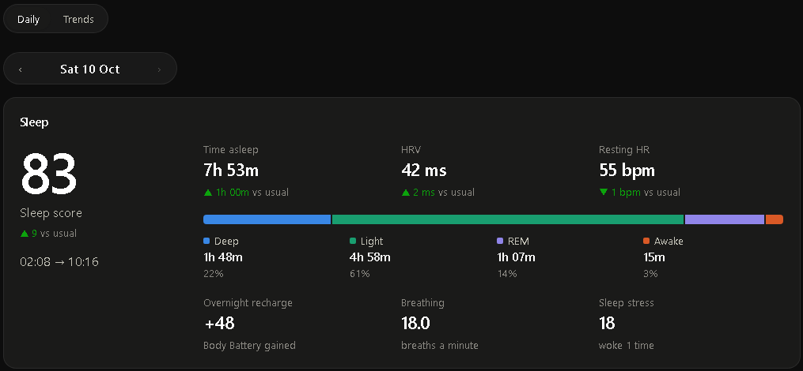
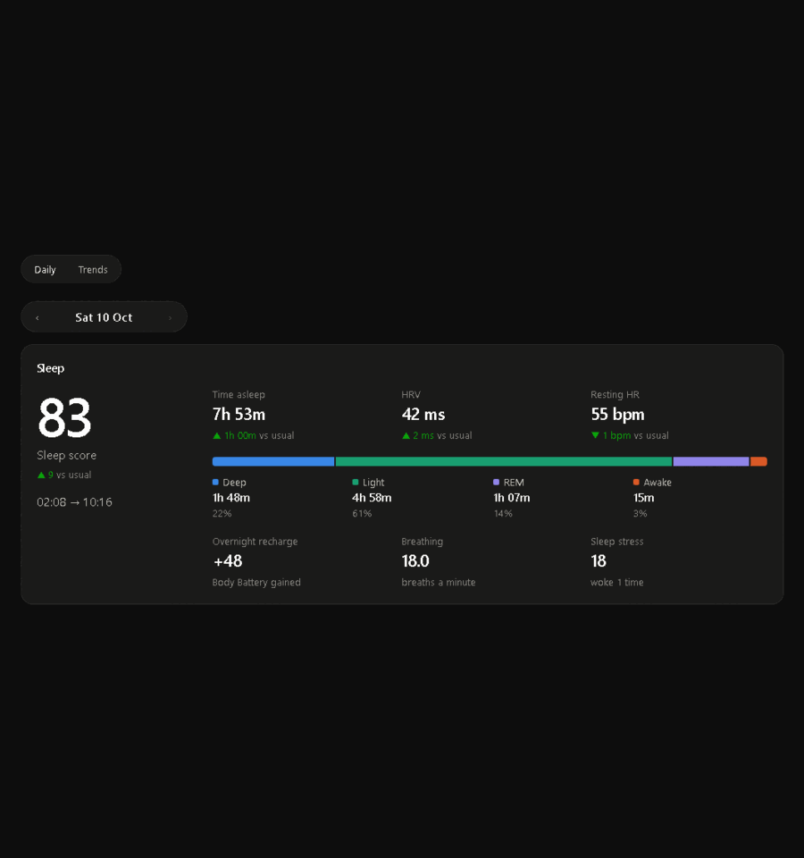
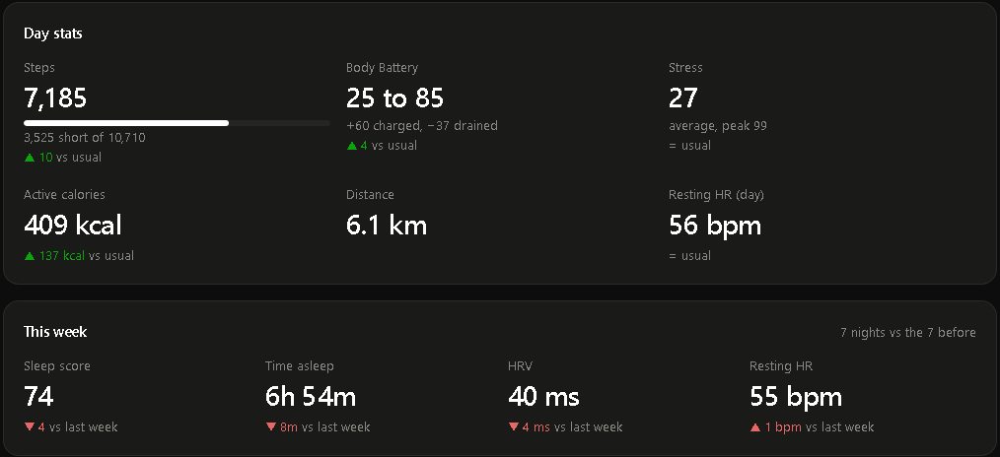
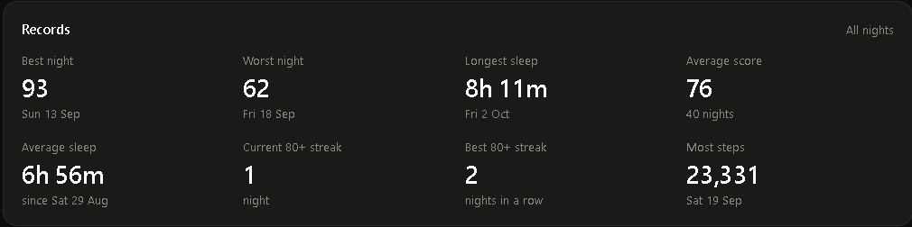
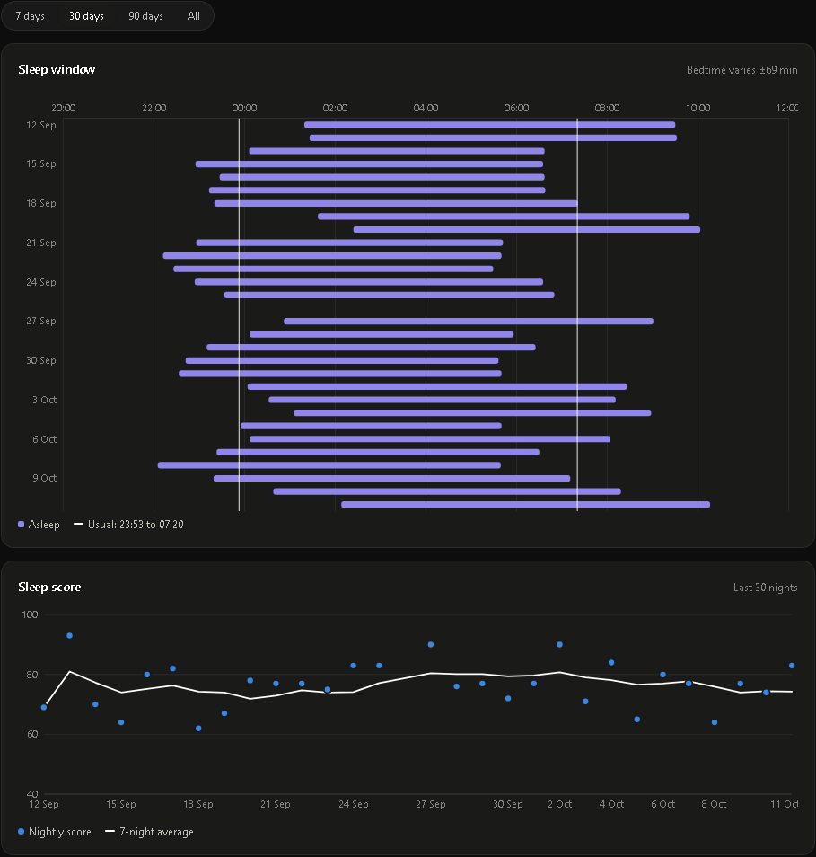
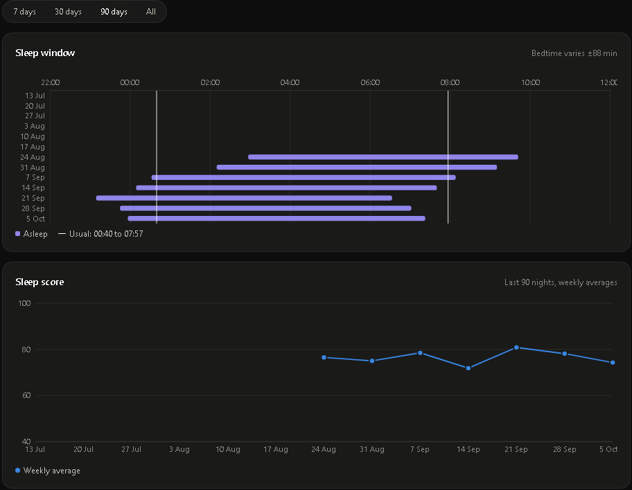
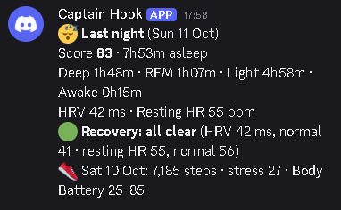
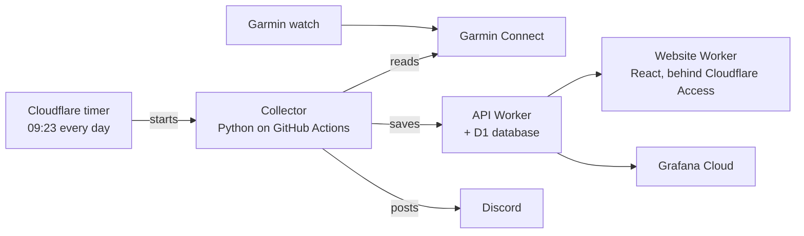

# Garmin Health Monitor

**A personal sleep and recovery dashboard for my Garmin watch. It updates itself every morning and runs entirely on free plans.**

**Docs:** [**How it works**](docs/GUIDE.md) · [**Setup**](docs/SETUP.md) · [**Garmin sign-in**](docs/GARMIN_SETUP.md) · [**How it was built**](docs/ROADMAP.md)

## What it does

- **A morning sleep report.** Score, time asleep, sleep stages, HRV and resting heart rate, each compared with your usual. Every night's report has its own page.
- **An early warning.** A green, amber or red recovery light compares HRV and resting heart rate with your own 30-night normal. That pattern often shifts a day or two before you feel ill or run down.
- **Plain-English summaries.** "A good night. You slept 7h 53m, 1h more than usual…", written from the numbers by simple rules. No AI, no cost.
- **Trends and insights.** Sleep window, sleep debt, records and streaks. It also shows which of your habits go with better nights (bedtime, steps, stress) and your best night of the week.
- **A Discord message every morning**, with no manual steps. Your watch syncs, and the rest happens on its own.

## Why I built it

- **Own the data.** Garmin's app shows a day at a time. I wanted my own history, my own comparisons, and charts that answer *my* questions.
- **Catch problems early.** Small changes in HRV and resting heart rate are one of the best early signs of illness or overtraining. A daily light makes them hard to miss.
- **Learn a real full-stack system on free infrastructure.** That means scheduled jobs, an API, a database, a protected website, monitoring, tests and CI, built and run like a production service at zero cost.
- **Keep every insight explainable.** Each sentence and warning comes from a rule you can read in the code, not a black box.

## Quick tour

  

Last night's sleep, the day's stats, personal records, then 30-day and 90-day trends. If it doesn't play by itself, click it: GitHub pauses animations when your device is set to reduce motion.

## Screenshots

| | |
| --- | --- |
|  |  |
| **Daily:** the day's steps, Body Battery and stress, and this week vs last | **Trends:** personal records across every night |
|  |  |
| **30 days:** when you fell asleep and woke, and your score with a 7-night average | **90 days:** long ranges switch to weekly averages |

### Every morning in Discord

Last night's score and stages, HRV and resting heart rate, the recovery light, and the day before's steps, stress and Body Battery. It arrives after the 09:23 run, with no app to open.

## How it works

1. **Every morning at 09:23** a Cloudflare timer starts the collector on GitHub Actions. GitHub's own schedule runs hours late, so Cloudflare starts it on time.
2. **The collector** signs in to Garmin Connect with saved tokens (never a password in the cloud). It reads the last few nights and days and sends them to the API.
3. **The API** is a Cloudflare Worker with a D1 (SQLite) database. It stores everything and serves it back with 7-night averages already worked out.
4. **The website** is a React app on a second Worker, behind Cloudflare Access, so only I can open it. The browser never holds an API token. The website's Worker adds it on the server side.
5. **Discord** gets the morning summary. **healthchecks.io** emails me if a run doesn't happen. **Grafana** has a second dashboard and a "data is stale" alert.

## Tech stack

| Part | Built with |
| --- | --- |
| Collector | Python 3.11, [uv](https://docs.astral.sh/uv/), `garminconnect`, Pydantic, pytest, Ruff |
| API | Cloudflare Workers, [Hono](https://hono.dev), Zod, D1 (SQLite), Vitest |
| Website | React, TypeScript, Vite, [Recharts](https://recharts.org), react-spring, Cloudflare Access (JWT checked with `jose`) |
| Automation | GitHub Actions (CI, daily collect, deploys), Cloudflare Cron Triggers, Dependabot |
| Monitoring | Discord webhooks, healthchecks.io, Grafana Cloud |

## Engineering and best practices

**Security**
- **No password in the cloud.** Garmin is signed in once, on my laptop. The daily job only uses saved tokens, refreshed on every run and carried over between runs.
- **Secrets stay secret.** Every key lives in GitHub or Cloudflare secrets, never in the code. Personal health data and token files are git-ignored.
- **Least privilege.**
  - The collector's token can only write. The website's token can only read.
  - The browser never holds either: the website's Worker adds the read token on the server side.
  - The GitHub token Cloudflare uses can only start this repo's Actions.
- **Locked-down website.** Cloudflare Access lets only me in, the Worker checks the Access login itself (JWT), and it only allows reads.

**Quality**
- **Tests at every layer, about 150 in total.**
  - collector parsing against real-shaped Garmin data
  - the API running in a local Workers runtime
  - an end-to-end test that runs the collector against a real local API
  - unit tests for every chart helper and insight rule
- **CI on every pull request**, on Linux and Windows. It covers linting (Ruff), formatting, type checks (TypeScript), all tests and a production build.
- **Small pull requests, merged only when green.** Each one explains what changed and why.
- **Dependabot keeps things up to date.** It opens pull requests for new versions of every dependency: weekly for the Python collector, monthly for the API, the website and the GitHub Actions. Updates are grouped, so each part gets one pull request. CI tests every update before it's merged. Known-incompatible upgrades, like vitest 5 with the Workers test pool, are held back with a note explaining why.

**Reliability**
- **On time, every day.** A Cloudflare timer starts the run at 09:23, plus a backup schedule that skips itself if the day's run already worked.
- **Safe to re-run.** Every save overwrites by date, so retries and overlapping fetches never create duplicates. Each run re-reads the last 3 days (14 on Sundays) to catch late watch syncs.
- **Fails loudly.**
  - A ❌ Discord ping if a run fails.
  - healthchecks.io emails me if no run arrives.
  - A Grafana alert if the data goes stale.
  - A warning two weeks before the Garmin sign-in would expire.

**Design**
- **Explainable insights.** Every summary sentence, warning and comparison is a short rule in TypeScript or Python, with tests. No AI, no running cost.
- **Accessible charts.** One colour per measure, with side-by-side pairs checked for colour-blind readers in light and dark mode. Every chart has a tooltip, and colour is never the only signal.
- **Runs on free plans only.** It works within the limits of each, for example D1's 50-queries-per-request cap.

## Run your own

You'll need a Garmin watch and free Cloudflare, GitHub and (optionally) Discord accounts. About 30 minutes:

1. **Garmin:** sign in once on your laptop with `uv run sleep-collector login`. See [`docs/GARMIN_SETUP.md`](docs/GARMIN_SETUP.md).
2. **Cloudflare:** create the D1 database and deploy the API Worker. See [`docs/SETUP.md`](docs/SETUP.md) step 1.
3. **GitHub:** add the secrets so the daily run can push data. See [`docs/SETUP.md`](docs/SETUP.md) step 4.
4. **First run:** Actions → collect → Run workflow, to backfill your history.
5. **Website and on-time timer:** deploy `web/`, put it behind Cloudflare Access, and add the GitHub token for the 09:23 start. See [`docs/SETUP.md`](docs/SETUP.md) step 6.

## Docs

| Doc | What's inside |
| --- | --- |
| [**How it works**](docs/GUIDE.md) | Every part of the system, from the watch to the website, and what each card and chart means |
| [**Setup**](docs/SETUP.md) | Step-by-step: Cloudflare, healthchecks.io, GitHub secrets, the first run and the 09:23 timer |
| [**Garmin sign-in**](docs/GARMIN_SETUP.md) | The one-time Garmin sign-in on your laptop, and how the saved tokens keep working |
| [**How it was built**](docs/ROADMAP.md) | The build history, one small slice at a time |
| [**Grafana dashboard**](grafana/sleep-dashboard.json) | An importable Grafana dashboard that reads the same API |

## License

[MIT](LICENSE). Use it, learn from it, adapt it for your own watch.
