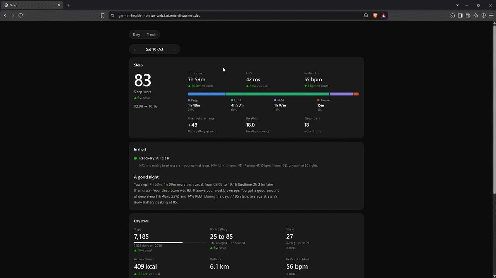
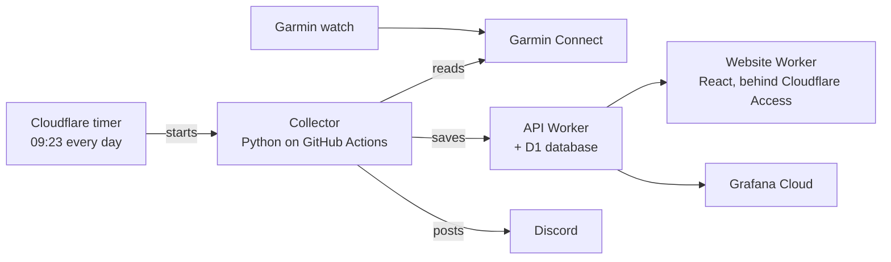

# Garmin Health Monitor

**A private sleep and recovery dashboard for my Garmin watch. It updates itself every morning and runs entirely on free plans.**

## What it does

- **A morning sleep report.** Score, time asleep, sleep stages, HRV and resting heart rate, each compared with your usual. Every night's report has its own page.
- **An early warning.** A green, amber or red recovery light compares HRV and resting heart rate with your own 30-night normal. That pattern often shifts a day or two before you feel ill or run down.
- **Plain-English summaries.** "A good night. You slept 7h 53m, 1h more than usual…", written from the numbers by simple rules. No AI, no cost.
- **Trends and insights.** Sleep window, sleep debt, records and streaks. It also shows which of your habits go with better nights (bedtime, steps, stress) and your best night of the week.
- **A Discord message every morning**, with no manual steps. Your watch syncs, and the rest happens on its own.

## Why I built it

- **Own the data.** Garmin's app shows a day at a time. I wanted my own history, my own comparisons, and charts that answer *my* questions.
- **Catch problems early.** Small changes in HRV and resting heart rate are one of the best early signs of illness or overtraining. A daily light makes them hard to miss.
- **Learn a real full-stack system on free infrastructure.** That means scheduled jobs, an API, a database, a protected website, monitoring, tests and CI, built and run like a production service at zero cost.
- **Keep every insight explainable.** Each sentence and warning comes from a rule you can read in the code, not a black box.

## Screenshots

| | |
| --- | --- |
|  |  |
| **Daily:** the day's steps, Body Battery and stress, and this week vs last | **Trends:** personal records across every night |
|  |  |
| **30 days:** when you fell asleep and woke, and your score with a 7-night average | **90 days:** long ranges switch to weekly averages |

  
  &nbsp;
  

## How it works

1. **Every morning at 09:23** a Cloudflare timer starts the collector on GitHub Actions. GitHub's own schedule runs hours late, so Cloudflare starts it on time.
2. **The collector** signs in to Garmin Connect with saved tokens (never a password in the cloud). It reads the last few nights and days and sends them to the API.
3. **The API** is a Cloudflare Worker with a D1 (SQLite) database. It stores everything and serves it back with 7-night averages already worked out.
4. **The website** is a React app on a second Worker, behind Cloudflare Access, so only I can open it. The browser never holds an API token. The website's Worker adds it on the server side.
5. **Discord** gets the morning summary. **healthchecks.io** emails me if a run doesn't happen. **Grafana** has a second dashboard and a "data is stale" alert.

## Tech stack

| Part | Built with |
| --- | --- |
| Collector | Python 3.11, [uv](https://docs.astral.sh/uv/), `garminconnect`, Pydantic, pytest, Ruff |
| API | Cloudflare Workers, [Hono](https://hono.dev), Zod, D1 (SQLite), Vitest |
| Website | React, TypeScript, Vite, [Recharts](https://recharts.org), react-spring, Cloudflare Access (JWT checked with `jose`) |
| Automation | GitHub Actions (CI, daily collect, deploys), Cloudflare Cron Triggers, Dependabot |
| Monitoring | Discord webhooks, healthchecks.io, Grafana Cloud |

## Engineering highlights

- **Security first.**
  - Garmin is signed in once, on my laptop. CI only ever uses refreshed tokens, which carry over between runs.
  - Every secret lives in GitHub or Cloudflare, never in the code.
  - The website checks the Cloudflare Access login itself and only allows reads.
- **Tested end to end.** About 150 tests across the three parts:
  - parsing against real-shaped Garmin data
  - the API running in a local Workers runtime
  - an end-to-end test that runs the collector against a real local API
  - unit tests for every insight rule

  CI runs on every pull request, on Linux and Windows.
- **Self-healing daily job.**
  - On-time start, plus a backup schedule that skips itself if the day's run already worked.
  - Re-sending data is always safe: every save overwrites by date.
  - Each run re-reads the last 3 days (14 on Sundays), so a late watch sync is picked up the next morning.
- **Runs on free plans only.** It works within the limits of each, for example D1's 50-queries-per-request cap.

## Run your own

You'll need a Garmin watch and free Cloudflare, GitHub and (optionally) Discord accounts. About 30 minutes:

1. **Garmin:** sign in once on your laptop with `uv run sleep-collector login`. See [`docs/GARMIN_SETUP.md`](docs/GARMIN_SETUP.md).
2. **Cloudflare:** create the D1 database and deploy the API Worker. See [`docs/SETUP.md`](docs/SETUP.md) step 1.
3. **GitHub:** add the secrets so the daily run can push data. See [`docs/SETUP.md`](docs/SETUP.md) step 4.
4. **First run:** Actions → collect → Run workflow, to backfill your history.
5. **Website and on-time timer:** deploy `web/`, put it behind Cloudflare Access, and add the GitHub token for the 09:23 start. See [`docs/SETUP.md`](docs/SETUP.md) step 6.

## Docs

- [`docs/GUIDE.md`](docs/GUIDE.md): how every part works, and what each card and chart on the website means
- [`docs/SETUP.md`](docs/SETUP.md) and [`docs/GARMIN_SETUP.md`](docs/GARMIN_SETUP.md): step-by-step setup
- [`docs/ROADMAP.md`](docs/ROADMAP.md): how it was built, one small slice at a time
